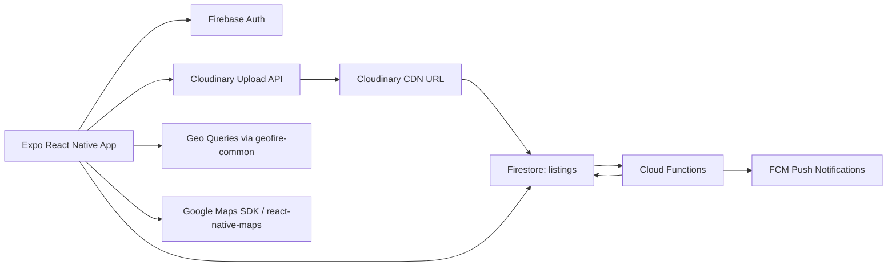

# FoodDrop (Full Stack MVP)

FoodDrop is a full-stack mobile MVP for sharing extra food from homes and restaurants with nearby receivers in real-time.

## What is implemented

### Mobile app (Expo + React Native)
- Receiver map view with nearby listings and color-coded markers.
- Nearby feed sorted by distance and freshness signal.
- Giver listing creation flow (name, quantity, type, photo, pickup window).
- Cloudinary image upload from device gallery.
- My listings management (mark out-of-stock and delete).
- Freshness badge rendering (`green`, `yellow`, `red`).

### Backend (Firebase)
- Firestore data model and geohash-backed location storage.
- Firestore rules so only owner can modify their own listings.
- Storage rules with auth + image size limits.
- Scheduled Cloud Function to expire stale listings every 30 minutes.
- Triggered Cloud Function to notify nearby users of new listings.

## Architecture



## Listing schema (`listings/{listingId}`)

```ts
{
  listingId: string,
  userId: string,
  userType: "home" | "hotel",
  foodName: string,
  foodType: "veg" | "non-veg" | "cooked" | "raw",
  prepTime: Timestamp,
  quantity: string,
  imageUrl: string,
  status: "available" | "empty" | "expired",
  location: {
    lat: number,
    lng: number,
    geohash: string
  },
  pickupWindow: {
    startAt: string,
    endAt: string
  },
  expiresAt: Timestamp,
  createdAt: Timestamp
}
```

## Nearby algorithm

- Build geohash ranges via `geohashQueryBounds(center, radiusMeters)`.
- Query Firestore by geohash intervals and `status == "available"`.
- Filter by true distance using `distanceBetween`.
- Sort results by `distance ASC`, then `prepTime DESC`.

Default radius is 5 km (expandable in code).

## Auto-expiry

- Function: `expireOldListings`
- Trigger: every 30 minutes
- Logic: listings with `status == "available"` and `expiresAt <= now` become `expired`.

## Security

- Posting requires authenticated Firebase user.
- Firestore Rules:
  - anyone can read listings
  - only owner can update/delete listing
- Storage Rules:
  - only authenticated owner can upload under their folder
  - max 5 MB
  - images only

## Project structure

```
.
├── App.tsx
├── src
│   ├── components
│   ├── config
│   ├── hooks
│   ├── screens
│   ├── services
│   ├── types
│   └── utils
├── functions
│   └── src/index.ts
├── firestore.rules
├── firestore.indexes.json
├── storage.rules
└── firebase.json
```

## Local setup

### 1) Install dependencies
```bash
npm install
cd functions && npm install && cd ..
```

### 2) Configure env
Copy `.env.example` to `.env` and fill Firebase + Cloudinary values.

### 3) Run app
```bash
npm run start
```

### 4) Run Firebase emulators (optional)
```bash
firebase emulators:start
```

### 5) Build functions
```bash
cd functions
npm run build
```

## Notes

- This repo is an MVP foundation: auth screens, robust validation, offline support, and production error handling should be added before production launch.
- For FCM in Expo production builds, move from Expo token flow to native FCM/APNs registration as needed by your deployment strategy.
